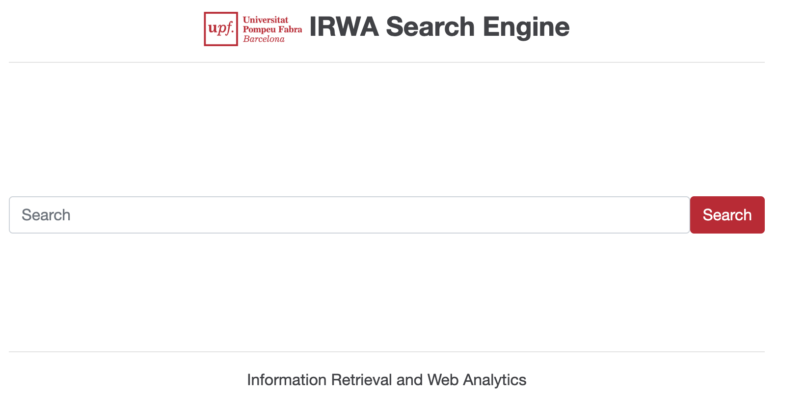

# Information Retrieval and Web Analytics (IRWA) - Final Project

<table>
  <tr>
    <td style="vertical-align: top;">
      
    </td>
    <td style="vertical-align: top;">
      Search engine with web analytics over a collection of fashion products (Flipkart dataset).
      Parts 1 to 3 (preprocessing and EDA, indexing and evaluation, ranking) are in <code>project_progress</code>,
      and Part 4 is a web application implemented with Python and Flask.
    </td>
  </tr>
</table>

----
## Project Structure

```
/IRWA_project
├── myapp                    # Main application logic
│   ├── search
│   │   ├── preprocess.py    # Text preprocessing (Part 1)
│   │   ├── algorithms.py    # Inverted index, AND search and TF-IDF ranking (Part 2)
│   │   ├── evaluation.py    # Evaluation metrics (Part 2)
│   │   ├── load_corpus.py   # Loads the corpus for the web app
│   │   ├── objects.py       # Document and result objects of the web app
│   │   └── search_engine.py # Search engine used by the web app
│   ├── analytics            # Web analytics (Part 4)
│   ├── generation           # RAG generation (Part 4)
│   └── core                 # Utilities
├── templates                # HTML templates for the Flask application
├── static                   # Static assets (images, CSS)
├── data                     # Datasets (not uploaded to GitHub, see Usage)
├── project_progress         # Solutions of Parts 1, 2 and 3 (report, notebook and README)
│   ├── part_1
│   ├── part_2
│   └── part_3
├── config.yaml              # Paths, indexed fields, test and validation queries
├── .env.example             # Example of environment variables (copy it to .env)
├── .gitignore
├── LICENSE
├── requirements.txt         # Python dependencies
├── web_app.py               # Main Flask application
└── README.md
```

----
## Setting up the Python environment (only the first time)

From the root of the project, create and activate a virtual environment and install the dependencies:
```bash
python3 -m venv irwa_venv
source irwa_venv/bin/activate        # Windows: irwa_venv\Scripts\activate.bat
pip install -r requirements.txt
```

If you add new packages, update `requirements.txt` with:
```bash
pip freeze > requirements.txt
```

## Usage

0. Put the dataset `fashion_products_dataset.json` in the `data` folder. The validation labels
   (`validation_labels.csv` and `validation2_labels.csv`) are already in the repository.
1. Copy `.env.example` to `.env` and add your Groq API key (`.env` is in `.gitignore` and must never be uploaded).
2. Parts 1, 2 and 3 are in `project_progress`. Each part has its report (`.pdf`), its notebook (`.ipynb`)
   and a `README.md` that explains how to reproduce the results.
   - **Part 1**: `project_progress/part_1/eda.ipynb` creates `data/processed_fashion_products.json` the first time and runs the EDA.
   - **Part 2**: `python project_progress/part_2/main.py` builds the index, runs the test queries and computes the evaluation
     metrics. `project_progress/part_2/indexing_stats.ipynb` computes all the tables and figures of the report.
3. Part 4 (web application) is started with:
```bash
python web_app.py
```
   and opened in the browser at [http://127.0.0.1:8088/](http://127.0.0.1:8088/).

## Attribution
The repository structure and the web application are adapted from the
[IRWA Final Project template](https://github.com/trokhymovych/irwa-search-engine).
